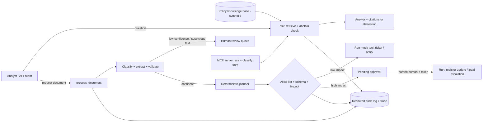

# OpsBridge AI

**A governed AI workflow for policy and content operations.** It turns incoming request documents into tracked work, answers policy questions *only* from approved sources, and makes sure a human approves anything high-impact. Built to show how an AI automation is designed, controlled, tested and delivered, not only coded.

> All data in this repository is **synthetic** (a fictional company's policies and requests). No real customer, employee or production data is used. No cloud service is called by default and nothing here has been deployed to production.

## Business problem
Policy Operations and Content Operations teams receive many small requests (policy changes, takedowns, vendor onboarding, access, exceptions) by email. People read each one, work out what it is, copy details into a ticketing system, chase approvals, and answer the same policy questions again and again. That is slow, inconsistent and hard to audit.

**Intended users:** operations analysts (faster, consistent intake), policy owners (cited answers, clear approvals), security/compliance (audit trail, no uncontrolled automation), delivery managers (measurable quality gates).

## What it does
| Capability | How |
|---|---|
| Cited answers | BM25 retrieval over the policy knowledge base; the answer is taken from the retrieved text with document/chunk citations |
| Abstention | If the best chunk covers too little of the question (idf-weighted coverage < 0.30) the system says it does not know and cites nothing |
| Document processing | Classify the request, extract and validate fields, score confidence; low confidence or instruction-like text goes to **human review** |
| Controlled automation | Allow-listed tools with Pydantic-validated arguments; low-impact tools run, **high-impact tools wait for a named human approver** |
| Audit & tracing | Every request has a trace id with timed spans; audit events are redacted (emails, phones, card/SSN-like numbers, secrets) |
| Interfaces | CLI, FastAPI service (approval endpoint locked behind a token), MCP server (read-only tools only) |
| Optional LLM | Amazon Bedrock provider (default region `ap-southeast-2`) implemented but **off by default**, with a hard call cap; a live call reached Bedrock and was refused with a daily-token quota message (new account), so it is stub-tested only |
| Quality gate | `python -m opsbridge.evaluate` computes metrics and fails if any gate is missed |

## Architecture

More detail: [docs/ARCHITECTURE.md](docs/ARCHITECTURE.md). Requirements and acceptance criteria: [specs/SPECS.md](specs/SPECS.md).

## Quick start
```bash
python -m venv .venv && source .venv/bin/activate        # Windows: .venv\Scripts\activate
pip install -r requirements.txt
python -m pytest -q                                       # 79 tests
python demo/run_demo.py                                   # full scenario, offline
python -m opsbridge.cli ask "How long is published content kept before it is archived?"
python -m opsbridge.cli process data/inbox/D02.txt
python -m opsbridge.cli approvals list
python -m opsbridge.evaluate                              # quality gate
uvicorn opsbridge.api:app                                 # API (set OPSBRIDGE_APPROVER_TOKEN to enable approvals)
```

## Example output (real, from `python demo/run_demo.py`; full file: [docs/demo_output.txt](docs/demo_output.txt))
```text
Q: How long is published content kept before it is archived?
A: Published content is retained in the active repository for 24 months after publication. ...
   cite -> POL-001#1 (Content Retention Policy)

Q: What is the company holiday calendar for next year?
A: I do not have enough evidence in the policy knowledge base to answer that.   abstained=True

D02: type=content_takedown_request  confidence=1.0  route=auto
   action create_ticket          -> executed
   action escalate_to_legal      -> pending_approval
self-approval refused: approver must be a named human, not the workflow
approved by Dana Wu: escalate_to_legal -> legal case 0a1fe52a
```

## Tests and results (run on 2026-10-20, Python 3.11, Windows)
- `python -m pytest -q` -> **79 passed**. Every specification in `specs/SPECS.md` is linked to tests; [docs/TRACEABILITY.md](docs/TRACEABILITY.md) is generated on each run, and a test fails if a spec has none.
- `python -m opsbridge.evaluate` -> gate **passed**: hit@3 1.00, citation precision 1.00, abstention accuracy 1.00, false-abstain rate 0.00, classification 1.00, routing 1.00, field accuracy 1.00, unsafe executions 0; latency p50 about 1 ms, p95 about 3 ms (local, in-process). See [docs/EVALUATION.md](docs/EVALUATION.md).

**Read these numbers carefully.** The sets are tiny (24 questions, 12 documents), synthetic, and were also used while developing, so 1.00 means "no regressions on my own examples", not "accurate in the real world". The abstain threshold (0.30) was chosen from the gap in this small set (highest out-of-scope 0.17, lowest in-scope 0.41); at 0.45 the system wrongly abstained on 2 of 18 valid questions. Ragas and LLM-judge metrics were **not** run.

## Deployed on AWS (and removed again)
On 2026-10-20 the system ran on real AWS in Sydney (API Gateway HTTP API -> Lambda -> DynamoDB, secrets in SSM Parameter Store, least-privilege role) using Free-plan credits, then was destroyed. Evidence: [docs/aws_live_run.txt](docs/aws_live_run.txt) and [docs/AWS_LIVE_PLAN.md](docs/AWS_LIVE_PLAN.md). Notes: a Free-plan account is locked to its assigned region (here Sydney), which an organisation policy enforces; the deploy tool refuses to run unless the account is FREE/ACTIVE with credits; the live run exposed a real bug (timestamps being redacted) that the tests missed, now fixed. It is **not** left running.

## Security, privacy and cost
- Synthetic data only; `.env` and `runs/` are git-ignored; CI runs a secret scan.
- Documents are data: text inside a request can never add, change or approve a tool call. Instruction-like text is flagged and sent to review.
- High-impact actions need a named human approver; the workflow cannot approve itself; each decision is single-use; the MCP server exposes no approval capability.
- Audit and trace data are redacted before writing; person **names** are not treated as secrets by the regex redactor (limitation).
- The approval API is disabled unless a token is set. For production, place the API behind your identity provider; the token is a minimal local control.
- **Cost:** the default build runs entirely locally at no cost. The optional Bedrock provider (default region `ap-southeast-2`) bills per token and must only be enabled after a cost review and explicit approval.

## IJP competencies demonstrated
See [docs/IJP_MAPPING.md](docs/IJP_MAPPING.md): process automation, AI-first solution design, tool-calling and MCP, evaluation, tracing, spec-driven delivery, governance, and stakeholder-ready documentation, with an honest list of what is **not** covered.

## Limitations and future work
- Retrieval is lexical (BM25); **no vector database or embeddings** yet. The `Retriever` interface is where Chroma/pgvector/OpenSearch would plug in.
- Extraction is rule-based; no LLM extraction, no OCR/scanned documents, English only, synthetic emails only.
- Tools are mocks (JSONL files), not real ticketing or policy systems.
- Tracing is a small local implementation, not Langfuse/Arize/OpenTelemetry export.
- No load test beyond a few calls; the CI workflow has not run on GitHub yet; the AWS deployment was a short-lived demo, not a production rollout.
- Next: embeddings + vector store comparison, LLM extraction behind the same schema, Ragas/LLM-judge evaluation, OTel export, SSO in front of the API, real integrations.

## Interview talking points
See [docs/INTERVIEW.md](docs/INTERVIEW.md) (technical and delivery-management questions with answer frameworks).

## Video
Walkthrough videos are produced separately (script in `docs/`); a link will be added here when a verified recording exists.
