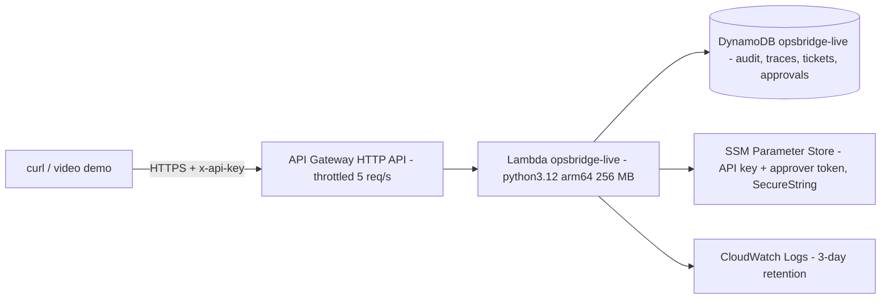

# OpsBridge on AWS - live demo plan (needs approval before anything is created)

**Status: PLAN ONLY. Nothing has been created in AWS.** Tests for the cloud code run against a local AWS mock (moto).

## Why
To show the system answering real HTTPS requests from the cloud, with approvals and audit records stored in a managed database, so the story is "built, tested **and** run on AWS" - at a cost of cents, deleted straight after recording.

## Architecture (region ap-south-1, Mumbai)

Answers are extractive (no LLM). **Bedrock is not used** and would be a separate, separately-approved step.

## Free-plan safety (you cannot afford paid AWS: this is designed around that)
- Your account's plan, read from the Free Tier API on 2026-10-20: **FREE, ACTIVE, USD 120 credits remaining, plan ends 2027-04-16**.
- AWS documentation: on a Free plan, usage is covered by credits and you are **not billed**; when credits run out or the plan period ends the **account closes** (data kept 90 days) unless you upgrade to a Paid plan. So the risk is losing the account, not receiving a bill.
- **Never click "Upgrade to Paid plan"**, and avoid actions AWS says auto-upgrade a Free account (for example Control Tower, AWS Partner Network, Professional Services contracts, Enterprise Agreements).
- The deploy tool re-checks the plan before creating anything and **refuses unless the plan is FREE/ACTIVE with at least USD 20 in credits**. There is no command-line flag to bypass it.
- The demo's expected use is a few cents of the USD 120. Free plans also exclude services that could drain credits, which is probably why the organisation policy blocks several services.
- Sources: https://docs.aws.amazon.com/awsaccountbilling/latest/aboutv2/free-tier-plans.html and https://docs.aws.amazon.com/accounts/latest/reference/upgrade-account.html. Credit-expiry wording differs between AWS pages; check the Credits page in the console.

## Resources (all named `opsbridge-live*`, tagged `project=opsbridge`)
DynamoDB table (on-demand, TTL), CloudWatch log group (3 days), IAM role `opsbridge-live-lambda` (least privilege: this table, this log group, two parameters), two SSM SecureString parameters, Lambda function, HTTP API with throttling. **Not created:** EC2, RDS, NAT gateway, load balancer, KMS customer key, Secrets Manager, any Bedrock call.

## Cost estimate (order of magnitude; verify in the AWS Pricing Calculator)
For a demo of about 500 requests: Lambda inside the free tier; HTTP API about USD 0.0006; DynamoDB about USD 0.003; logs about USD 0.001; SSM and IAM free. **Total under about USD 0.01-0.05, paid from your credits first.** No hourly charges, so idle cost is about zero, and everything is deleted after recording. Budgets and alerts are not hard spending caps; the throttle (5 requests per second) and the teardown are the real limits.

## Permissions needed (least privilege)
Your `portfolio-readonly` user has only `ReadOnlyAccess`. Deploying needs the extra policy in `deploy/deployer-policy.json`: write access limited to the one table, one function, one role, one log group and `/opsbridge/live/*` parameters, in ap-south-1 only; API Gateway actions cannot be limited by name, so they cover HTTP APIs in the region. It grants **no** EC2, RDS, S3, Bedrock, billing, IAM-user or IAM-policy permissions.
Safest sequence: (1) attach the policy to `portfolio-readonly`; (2) deploy, record, destroy; (3) **detach the policy again**. The policy is derived from the exact calls in `deploy/aws_live.py`; if the first run needs one more permission, I will show you the exact addition before you grant it.

## Known risk: organisation restrictions
This account's organisation policy already denies listing Lambda, EC2, RDS, DynamoDB, ECR, EKS and CloudFormation in the regions I tried. Creating resources may be blocked too. `apply` creates the cheap resources first and **rolls everything back automatically** if any step is denied. If Lambda or API Gateway is blocked, the fallback is to keep the local demo (nothing is lost) or to ask the account owner to lift the restriction.

## Steps after approval
1. You attach the policy (or let me do it through Claude in Chrome while you watch; I never type your credentials).
2. `python deploy/build_lambda_zip.py` (2.5 MB package, built for Linux arm64).
3. `python deploy/aws_live.py plan --profile portfolio-readonly` (no changes) then `apply ... --yes-i-approved-the-cost-and-permissions`.
4. Smoke test `/health`; run the live demo (ask, process a document, approve) with the generated API key; capture evidence (responses, DynamoDB items, CloudWatch log lines) with account identifiers hidden.
5. `python deploy/aws_live.py destroy --profile portfolio-readonly`; confirm in the console and Billing that nothing remains; detach the policy.

## Rollback
`destroy` removes: API, Lambda, SSM parameters, role policy and role, log group, table, local secrets file. It is safe to run twice and runs automatically when `apply` fails.

## Approval checklist
- [ ] Region ap-south-1 and the resource list above
- [ ] Estimated cost under about USD 0.05 from credits
- [ ] Attach `deploy/deployer-policy.json` to `portfolio-readonly` temporarily
- [ ] Teardown right after recording
